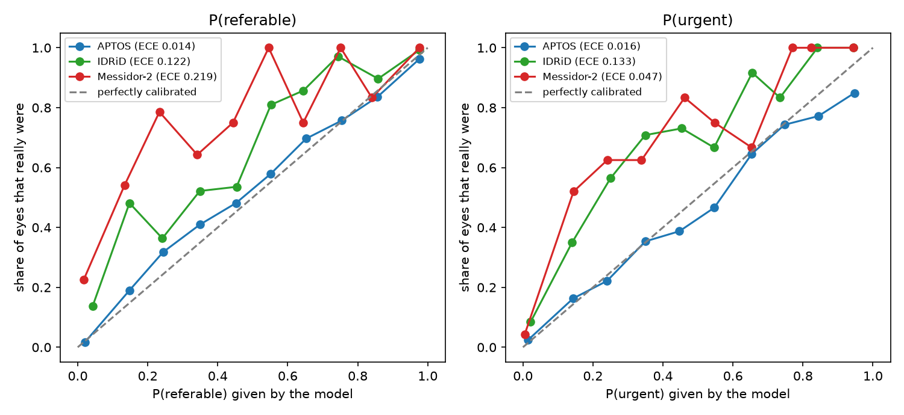
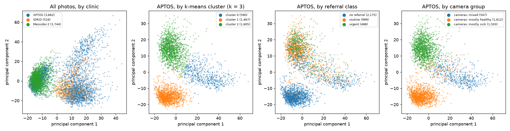

# Diabetic retinopathy referral triage with a sensitivity guarantee

Machine Learning course project, M.Tech (Data and Computational Sciences), IIT Jodhpur.
Swayam Sahu, Sahil Sihag, Nitesh Kumar.

## What the project does

People with diabetes need regular eye checks, because diabetic retinopathy (DR) can blind them before
they notice anything. From one photo of the retina (a fundus photo), the system decides what should
happen next:

* **no referral** (DR grade 0 or 1),
* **routine referral** to an eye doctor (grade 2),
* **urgent referral** (grade 3 or 4).

A plain classifier gives no promise about how many sick eyes it sends home. Our aim is a referral rule
with a stated guarantee:

* at most 10 % of the eyes that need a referral (grades 2-4) are sent home, and
* at least 90 % of the urgent eyes (grades 3-4) are referred urgently.

## Method in three lines

1. A pretrained network (ResNet-50) turns each photo into 2,048 numbers. We do not train it.
2. A simple classifier from the course is trained on those numbers and gives a probability for each class.
3. Conformal prediction turns the probabilities into a referral decision, with one threshold per class
   chosen on photos that were kept aside for this purpose (calibration photos).

## Data

Three public datasets. None of them is in this repository; download them and place them like this:

| Dataset | Role | Download | Folder |
|---|---|---|---|
| APTOS 2019 (3,662 photos, India) | training and testing | https://www.kaggle.com/competitions/aptos2019-blindness-detection/data | `datasets/aptos/` (`train.csv`, `train_images/`) |
| IDRiD, part B "Disease Grading" (516 photos, India) | a new clinic | https://ieee-dataport.org/open-access/indian-diabetic-retinopathy-image-dataset-idrid | `datasets/idrid/` (`1. Original Images/`, `2. Groundtruths/`) |
| Messidor-2 (1,748 photos, France) | a second new clinic | https://www.adcis.net/en/third-party/messidor2/ | `datasets/messidor2/IMAGES/` |
| Messidor-2 grades (Krause et al.) | labels for Messidor-2 | https://www.kaggle.com/datasets/google-brain/messidor2-dr-grades | `datasets/messidor2/messidor_data.csv` |

Messidor-2 images: Kindly provided by the Messidor program partners (see https://www.adcis.net/en/third-party/messidor/).
Messidor-2 grades: Krause et al., Ophthalmology 125(8), 2018.

The Messidor-2 licence does not allow passing the photos on, in any form, so no photo, crop or feature
file is stored here (`datasets/` and `data/` are ignored by git).

## Setup

```bash
python3.13 -m venv .venv && source .venv/bin/activate
pip install -r requirements.txt
```

The pretrained ResNet-50 weights (102 MB) go to `weights/resnet50_ram-a26f946b.pth`:
https://github.com/huggingface/pytorch-image-models/releases/download/v0.1-weights/resnet50_ram-a26f946b.pth
(SHA-256 `a26f946bdcb2e618263d03d8b60b66a26f7788dbadc1940c315b2bf62020a3e7`).

## Steps

Run every script from the project folder, in this order. Each one prints a short summary of what it did.

| Step | Command | What it does |
|---|---|---|
| 1 | `python src/01_list_photos.py` | lists every photo with its DR grade and referral class in one table |
| 2 | `python src/02_crop_photos.py` | crops each photo to its retina and resizes it to 224 x 224 |
| 3 | `python src/03_extract_features.py` | computes the 2,048 ResNet-50 features of each crop |
| 4 | `python src/04_make_folds.py` | finds copies of the same photo and splits APTOS into 10 folds |
| 5 | `python src/05_compare_models.py` | compares the course's models on the features with nested cross-validation (about 15 minutes) |
| 6 | `python src/06_referral_rule.py` | tests the referral rule (`src/conformal.py`) on APTOS against simpler rules |
| 7 | `python src/07_new_clinics.py` | applies the APTOS model and thresholds, unchanged, to IDRiD and Messidor-2 |
| 8 | `python src/08_recalibration.py` | sets the thresholds again with a few photos of the new clinic, and compares that with retraining (about 8 minutes) |
| 9 | `python src/09_fewer_sick_eyes.py` | tests the rule at clinics with fewer sick eyes, and forecasts the number of referrals from photos without labels |
| 10 | `python src/10_error_analysis.py` | counts the rule's errors by DR grade, camera and sharpness, and lists every missed urgent eye |
| 11 | `python src/11_more_scores.py` | adds the other scores of the proposal: weighted kappa, Brier score, calibration, and sensitivity, specificity and PPV per class |
| 12 | `python src/12_change_photos.py` | blurs, darkens and compresses the APTOS crops and computes their features (about 10 minutes) |
| 13 | `python src/13_robustness.py` | tests the rule on the worse photos, with parts of the pipeline changed, and with other targets (about 3 minutes) |
| 14 | `python src/14_clusters.py` | groups the photos with k-means and checks whether the groups follow the DR grade or the camera and clinic |
| 15 | `python src/15_camera_shortcut.py` | additional work: tests whether the model uses the camera as a shortcut, and compares five rules that try to keep the promise for each camera group |
| 16 | `python src/16_new_clinic_alarm.py` | additional work: an alarm that warns, without labels, when a clinic's photos are unlike the calibration photos; and the cameras of Messidor-2 after recalibration (about 4 minutes) |

Steps 2, 3 and 12 can be stopped and restarted; steps 2 and 3 take a few minutes each on a laptop.

## Results so far

**Step 5: which model reads the features best?** 3,662 APTOS photos, 10-fold nested cross-validation;
full table with 95 % intervals in [`results/models.csv`](results/models.csv).

| Model | AUROC referable | AUROC urgent | Accuracy |
|---|---|---|---|
| Logistic regression | 0.972 | 0.917 | 0.825 |
| LDA | 0.970 | 0.919 | 0.816 |
| SVM (RBF) | 0.970 | 0.910 | 0.824 |
| MLP | 0.966 | 0.875 | 0.790 |
| Gradient boosting | 0.963 | 0.898 | 0.799 |
| k-nearest neighbours | 0.957 | 0.878 | 0.774 |
| Random forest | 0.953 | 0.891 | 0.777 |
| AdaBoost | 0.944 | 0.873 | 0.763 |
| QDA | 0.941 | 0.881 | 0.775 |
| B2: photo size, brightness, sharpness only | 0.921 | 0.782 | 0.725 |
| Decision tree | 0.908 | 0.821 | 0.721 |
| Naive Bayes | 0.839 | 0.790 | 0.645 |
| B1: class shares | 0.494 | 0.492 | 0.594 |

Logistic regression, LDA and the SVM are within each other's intervals; we carry logistic regression
forward because it is the simplest. B2 never sees the retina and still reaches 0.921: in APTOS, the
camera and the image quality already say a lot about the grade, which we look at again in the error
analysis.

**Step 6: does the referral rule keep its promise?** Every APTOS photo is decided once, by a model and
thresholds that never saw it; full table in [`results/referral_rule.csv`](results/referral_rule.csv).

| Rule | Referable eyes sent home (target at most 10 %) | Urgent eyes referred urgently (target at least 90 %) | Healthy eyes sent home | To a grader | Referrals per 1,000 |
|---|---|---|---|---|---|
| Most likely class | 11.7 % | 51.0 % | 93.4 % | 0 % | 398 |
| B3 tuned cut-offs | 9.0 % | 87.9 % | 91.0 % | 0 % | 423 |
| B4 one conformal threshold | 6.6 % | 69.7 % | 89.2 % | 8.5 % | 358 |
| B5 unsure band | 7.9 % | 39.3 % | 90.8 % | 14.3 % | 286 |
| **C1 one threshold per class (ours)** | **4.4 %** | **91.4 %** | 87.2 % | 1.8 % | 446 |

Only C1 meets both targets (apart from the trivial rule of referring everyone urgently). With one
threshold for all classes (B4), the true class is in the set for 95.9 % of healthy eyes but only 69.7 %
of urgent eyes; with one threshold per class the three classes get 90.3 %, 90.9 % and 91.4 %. The price
of C1 is more referrals: 446 per 1,000 eyes, because 68 % of grade-2 eyes are referred urgently.

**Step 7: does the promise hold at a new clinic?** The same 10 models and thresholds as in step 6,
applied unchanged to all photos of IDRiD and Messidor-2 (average of the 10 rounds); full table with the
lowest and highest round in [`results/new_clinics.csv`](results/new_clinics.csv).

| Clinic | Rule | True class in the set (promised: 90 %) | Referable eyes sent home (target at most 10 %) | Urgent eyes referred urgently (target at least 90 %) | Referrals per 1,000 |
|---|---|---|---|---|---|
| APTOS (home) | B4 one conformal threshold | 90.3 % | 6.6 % | 69.7 % | 358 |
| APTOS (home) | C1 one threshold per class | 90.6 % | 4.4 % | 91.4 % | 446 |
| IDRiD | B4 one conformal threshold | 76.8 % | 16.8 % | 58.2 % | 391 |
| IDRiD | C1 one threshold per class | 82.2 % | 13.6 % | 87.0 % | 578 |
| Messidor-2 | B4 one conformal threshold | 75.3 % | 91.8 % | 19.2 % | 17 |
| Messidor-2 | C1 one threshold per class | 76.3 % | 87.1 % | 38.8 % | 44 |

No. The 90 % of conformal prediction holds only when the new photos are like the calibration photos, and
at a new clinic they are not. At IDRiD both rules slip below their targets. At Messidor-2 the rule
fails completely: the model gives almost every photo a high probability of "no referral" (0.96 on
average even for grade-2 eyes), so 87 % of the eyes that need a referral are sent home. The model's
ranking of referable eyes drops from an AUROC of 0.972 at APTOS to 0.910 at IDRiD and 0.684 at
Messidor-2. Thresholds set at one clinic cannot be carried to another; the next step sets them again
with a few photos of the new clinic.

The IDRiD row of B4 is also our check of Hasan et al. (2026), experiment E0 of the proposal. Trained on
APTOS with EfficientNet-B0, they report that standard conformal prediction covers 66 to 71 % of IDRiD
photos at a 90 % target (LAC, RAPS and APS scores; 77 % with their own ordinal score). With ResNet-50
trained on APTOS, LAC covers 68.4 %. B4 is the same LAC rule on frozen ResNet-50 features with
logistic regression and covers 76.8 %. We confirm the finding (coverage falls well below the 90 %
promised at a new clinic); how far it falls depends on the model. They use 455 graded IDRiD photos and
we use all 516, so the numbers are not directly comparable.

**Step 8: can a few local photos repair it?** The new clinic grades n of its own photos. We compare four
uses of them, each tested on the clinic's other photos (average of 50 runs); all sizes n = 50 to 300 and
the spread of the runs are in [`results/recalibration.csv`](results/recalibration.csv). With n = 300:

| Clinic | Rule | True class in the set (promised: 90 %) | Referable eyes sent home (target at most 10 %) | Urgent eyes referred urgently (target at least 90 %) | To a grader | Referrals per 1,000 |
|---|---|---|---|---|---|---|
| IDRiD | C1 nothing changed | 82.1 % | 13.6 % | 87.1 % | 5.5 % | 578 |
| IDRiD | **C2 thresholds set again on local photos (ours)** | **90.5 %** | **5.7 %** | **90.3 %** | 20.8 % | 553 |
| IDRiD | B6 model retrained with the local photos | 82.4 % | 6.8 % | 96.6 % | 3.3 % | 690 |
| IDRiD | B7 half to retrain, half to set thresholds | 91.4 % | 4.8 % | 91.6 % | 20.7 % | 566 |
| Messidor-2 | C1 nothing changed | 76.2 % | 87.1 % | 38.4 % | 0.2 % | 44 |
| Messidor-2 | **C2 thresholds set again on local photos (ours)** | **90.2 %** | **6.4 %** | **92.2 %** | 45.4 % | 411 |
| Messidor-2 | B6 model retrained with the local photos | 80.1 % | 46.8 % | 71.6 % | 8.2 % | 202 |
| Messidor-2 | B7 half to retrain, half to set thresholds | 90.8 % | 2.8 % | 95.6 % | 19.3 % | 740 |

Yes. Setting the thresholds again on local photos brings the 90 % back at both clinics and for every n
we tried, and both targets are met on average, without touching the model. Retraining alone (B6) does
not: 300 local photos among 2,900 APTOS photos barely move the model, and at Messidor-2 it still sends
home 47 % of the eyes that need a referral. B7 also keeps the promise, because it too sets its
thresholds on local photos, but it needs a new model for every clinic.

The guarantee does not make the model better, and the cost shows in the workload. At Messidor-2, where
the model ranks eyes poorly, the rule stays safe by being unsure: 45 % of the eyes go to a human grader.
With very few local photos it is safe but useless: among 50 Messidor-2 photos there are about 3 urgent
eyes, too few to set the urgent threshold, so every eye is referred urgently. About 200 to 300 local
photos are needed there before the rule starts to save work. The numbers are averages: a single clinic's
draw can land a few points on either side of the targets (see the ranges in the CSV).

**Step 9: what if the clinic has fewer sick eyes?** In APTOS 41 % of the eyes need a referral; in a
screening programme it is nearer 5 to 25 %. We draw clinics of 1,000 eyes with fewer referable eyes from
APTOS (average of 200 clinics); the spread is in [`results/fewer_sick_eyes.csv`](results/fewer_sick_eyes.csv).

| Referable eyes at the clinic | C1: referable eyes sent home (target at most 10 %) | C1: urgent eyes referred urgently (target at least 90 %) | B4: true class in the set | B4: urgent eyes with "urgent" in the set | C1: referrals per 1,000 | C1: referrals that were needed |
|---|---|---|---|---|---|---|
| 5 % | 4.0 % | 91.5 % | 95.2 % | 70.1 % | 151 | 31.1 % |
| 12.5 % | 4.5 % | 91.2 % | 94.2 % | 68.4 % | 214 | 55.0 % |
| 25 % | 4.6 % | 91.4 % | 92.5 % | 69.7 % | 316 | 74.2 % |
| 40.6 % (APTOS) | 4.4 % | 91.6 % | 90.3 % | 69.7 % | 446 | 85.4 % |

The promise does not move. Each class has its own threshold, set only on eyes of that class, so it does
not matter how many of them a clinic has. Standard conformal prediction (B4) looks better and better on
paper as sick eyes get rarer (95.2 % at 5 %), while it still covers only 70 % of the urgent eyes: one
promise for all eyes together is mostly a promise about the healthy ones. What does move is the
workload. At 5 % referable eyes C1 makes 151 referrals per 1,000 eyes instead of 446, and only 31 % of
them were needed.

A clinic should know that workload in advance. The forecast is 1000 x the sum over the classes of
(share of the class) x (how often the rule refers that class, measured on APTOS). The shares come from
APTOS (B8), from an estimate on the clinic's photos without labels (C3, ours; Saerens et al., 2002), or
from the truth (B9, not known in practice). Referrals per 1,000 eyes, and in brackets how far the forecast
is off on average; full table in [`results/workload_forecast.csv`](results/workload_forecast.csv).

| Clinic | Referable eyes: true | Referable eyes: estimated without labels | Referrals observed | Forecast B8 (APTOS shares) | Forecast C3 (estimated shares, ours) | Forecast B9 (true shares) |
|---|---|---|---|---|---|---|
| APTOS with 5 % referable | 5.0 % | 5.8 % | 151 | 445 (294) | 157 (11) | 151 (11) |
| APTOS with 12.5 % referable | 12.5 % | 13.0 % | 214 | 446 (232) | 218 (9) | 213 (11) |
| APTOS with 25 % referable | 25.0 % | 25.1 % | 316 | 447 (132) | 319 (7) | 318 (10) |
| IDRiD | 62.6 % | 60.9 % | 578 | 446 (131) | 612 (44) | 632 (55) |
| Messidor-2 | 26.2 % | 0.3 % | 44 | 446 (402) | 113 (69) | 326 (282) |

When only the share of sick eyes changes, the forecast from photos without labels is as good as with
the true shares (off by about 10 referrals per 1,000), and without a correction it is off by up to 294.
At the real clinics more than the shares has changed. At IDRiD the estimate is still close. At Messidor-2
it says 0.3 % referable eyes when the truth is 26.2 %, because the model calls almost every photo
healthy (step 7); even the true shares give a wrong forecast there, because the rule no longer refers
each class as often as it did at APTOS. The estimate without labels is safe to use only after the
model has been checked on some labelled local photos, and those photos (step 8) then give the shares
directly.

**Step 10: which eyes does the rule get wrong?** The decisions of step 6 on APTOS, counted group by group,
with 95 % intervals because some groups are small. APTOS does not name the camera; the photo size stands
for it, and cameras are grouped by what they photographed. Every camera on its own is in
[`results/errors_by_group.csv`](results/errors_by_group.csv).

| Group | Referable eyes | Sent home (target at most 10 %) | Urgent eyes | Not referred urgently (target at most 10 %) |
|---|---|---|---|---|
| All eyes | 1,487 | 4.4 % (3.5-5.6) | 488 | 8.6 % (6.4-11.4) |
| Grade 2 | 999 | 5.2 % (4.0-6.8) | | |
| Grade 3 | 193 | 1.6 % (0.5-4.5) | 193 | 7.3 % (4.4-11.8) |
| Grade 4 | 295 | 3.7 % (2.1-6.6) | 295 | 9.5 % (6.6-13.4) |
| Cameras with mostly healthy eyes | 55 | **52.7 % (39.8-65.3)** | 15 | 20.0 % (7.0-45.2) |
| Cameras with mixed eyes | 262 | 3.8 % (2.1-6.9) | 97 | 11.3 % (6.5-19.2) |
| Cameras with mostly sick eyes | 1,170 | 2.3 % (1.6-3.3) | 376 | 7.4 % (5.2-10.6) |
| Blurriest third | 583 | 4.6 % (3.2-6.7) | 216 | 8.8 % (5.7-13.3) |
| Middle third | 454 | 6.4 % (4.5-9.0) | 146 | 7.5 % (4.3-13.0) |
| Sharpest third | 450 | 2.2 % (1.2-4.0) | 126 | 9.5 % (5.5-15.9) |

The targets hold for each grade and each sharpness third, but not for each camera. On the cameras that
photographed mostly healthy eyes (in practice one camera, 1050 x 1050, with 974 photos of which 54 need
a referral), more than half of the eyes that need a referral are sent home. The model has learnt the
camera: a grade-2 eye gets an average P(no referral) of 0.74 on these cameras and 0.15 to 0.19 on the
others. This is the shortcut that B2 pointed to in step 5, and it is hidden in the overall 4.4 % because
these cameras hold only 55 of the 1,487 referable eyes. The guarantee of conformal prediction is an
average over the eyes of a class; it says nothing about a sub-group such as one camera.

The 42 missed urgent eyes (of 488) are listed in [`results/missed_urgent_eyes.csv`](results/missed_urgent_eyes.csv):
25 got a routine referral, 14 were sent home and 3 went to a grader. They are confident mistakes, not
near misses: their median P(urgent) is 0.043, against 0.538 for the urgent eyes that were caught, so a
slightly different threshold would not have caught them.

**Step 11: the other scores of the proposal.** APTOS photos are predicted by a model that never saw them
(the folds of step 6), IDRiD and Messidor-2 by one model trained on all of APTOS. Intervals are in
[`results/more_scores.csv`](results/more_scores.csv).

| Photos from | Accuracy | Quadratic weighted kappa | Brier score | ECE of P(referable) | ECE of P(urgent) |
|---|---|---|---|---|---|
| APTOS, B1 class shares only | 0.594 | 0.000 | 0.555 | 0.000 | 0.000 |
| APTOS | 0.822 | 0.781 | 0.247 | 0.014 | 0.016 |
| IDRiD | 0.624 | 0.627 | 0.503 | 0.122 | 0.133 |
| Messidor-2 | 0.744 | 0.150 | 0.466 | 0.219 | 0.047 |



At APTOS the probabilities can be read as risks: of the eyes given P(referable) near 0.4, about 40 %
are referable (ECE 0.014). At the new clinics they cannot. Both curves lie above the diagonal, so the
model gives sick eyes too low a risk, most of all at Messidor-2. Messidor-2 also shows why accuracy
alone misleads: 74 % of its photos are classified correctly because 74 % of its eyes are healthy and the
model calls nearly every eye healthy. The kappa of 0.150 says the agreement is barely better than
chance. (B1 has a calibration error of zero and is useless: calibration and ranking are different things.)

Sensitivity, specificity and PPV of each class, in percent ([`results/per_class.csv`](results/per_class.csv)):

| Photos from | Decision by | No referral | Routine | Urgent |
|---|---|---|---|---|
| APTOS | most likely class | 93.4 / 88.3 / 92.1 | 73.1 / 87.3 / 68.3 | 51.0 / 95.6 / 64.2 |
| APTOS | C1 (ours) | 87.2 / 95.6 / 96.6 | 24.2 / 95.9 / 69.1 | 91.4 / 73.6 / 34.7 |
| IDRiD | most likely class | 94.8 / 72.4 / 67.3 | 50.0 / 73.3 / 47.5 | 35.5 / 96.7 / 82.1 |
| Messidor-2 | most likely class | 99.8 / 5.5 / 74.8 | 0.0 / 99.3 / 0.0 | 12.7 / 99.8 / 77.8 |

The row of C1 shows what the guarantee buys and what it costs. The sensitivity for urgent eyes rises
from 51.0 % to 91.4 %, and a "no referral" from C1 is right 96.6 % of the time. In exchange only 34.7 %
of its urgent referrals are urgent eyes, because most grade-2 eyes are referred urgently to be safe.

**Step 13: worse photos, a simpler pipeline, a stricter target.** All on APTOS, tested as in step 6.

*Worse photos.* The model and the thresholds come from the original photos; the photos to decide are
blurred (radius 1.3 pixels), at half brightness, or saved as JPEG at quality 20. "Recalibrated" sets the
thresholds on calibration photos that are worse in the same way. Full table in
[`results/robustness.csv`](results/robustness.csv).

| Photos to decide | Thresholds | AUROC referable | True class in the set (promised 90 %) | Referable eyes sent home (target at most 10 %) | Urgent eyes referred urgently (target at least 90 %) | Healthy eyes sent home | To a grader |
|---|---|---|---|---|---|---|---|
| Original | original | 0.972 | 90.6 % | 4.4 % | 91.4 % | 87.2 % | 1.8 % |
| Blurred | original | 0.912 | 78.8 % | 11.8 % | 89.1 % | 75.4 % | 1.6 % |
| Blurred | recalibrated | 0.912 | 90.4 % | 4.2 % | 91.2 % | 59.4 % | 13.1 % |
| Half brightness | original | 0.966 | 90.3 % | 8.8 % | 86.9 % | 89.4 % | 2.9 % |
| Half brightness | recalibrated | 0.966 | 90.6 % | 5.7 % | 91.2 % | 86.9 % | 2.3 % |
| JPEG quality 20 | original | 0.857 | 67.1 % | 14.9 % | 86.7 % | 66.8 % | 1.0 % |
| JPEG quality 20 | recalibrated | 0.857 | 90.6 % | 4.2 % | 90.8 % | 38.7 % | 20.7 % |

Worse photos break the promise in the same way a new clinic does (step 7): the photos to decide are no
longer like the calibration photos. Blur and compression miss both targets. Darkness barely changes the
ranking (AUROC 0.966) but still shifts the probabilities enough to miss the urgent target. Setting the
thresholds on equally poor photos brings both targets back every time, as in step 8, and the cost is
again usefulness: with compressed photos only 39 % of healthy eyes are sent home and 21 % of all eyes
go to a grader.

*One part of the pipeline changed at a time* ([`results/ablations.csv`](results/ablations.csv)).

| Pipeline | AUROC referable | AUROC urgent | Referable eyes sent home | Urgent eyes referred urgently | Healthy eyes sent home | Referrals per 1,000 |
|---|---|---|---|---|---|---|
| As it is (standardise, PCA 100, C = 0.01) | 0.972 | 0.915 | 4.4 % | 91.4 % | 87.2 % | 446 |
| PCA with 20 components | 0.958 | 0.899 | 5.9 % | 91.0 % | 85.3 % | 427 |
| PCA with 300 components | 0.973 | 0.909 | 3.6 % | 90.6 % | 85.1 % | 455 |
| No PCA (all 2,048 features) | 0.973 | 0.912 | 2.8 % | 91.8 % | 83.8 % | 460 |
| No standardising | 0.965 | 0.917 | 5.0 % | 90.4 % | 87.3 % | 438 |
| Weaker regularisation (C = 1) | 0.971 | 0.913 | 4.6 % | 90.6 % | 86.9 % | 446 |
| Half of the training photos | 0.967 | 0.911 | 4.8 % | 90.4 % | 85.6 % | 447 |
| A tenth of the training photos | 0.954 | 0.877 | 2.8 % | 92.6 % | 75.4 % | 496 |

No single part matters much, and every variant meets both targets, because the guarantee does not
depend on how good the model is. A weaker model pays in workload instead: with a tenth of the training
photos (about 290) the rule still keeps its promise, but sends home 75 % of the healthy eyes instead
of 87 %. PCA with 100 components gives the same ranking as all 2,048 features with a twentieth of the numbers.

*Other targets* ([`results/stricter_target.csv`](results/stricter_target.csv)). The allowed miss rate of each class is alpha.

| alpha | True class in the set | Referable eyes sent home | Urgent eyes referred urgently | Healthy eyes sent home | To a grader | Referrals per 1,000 |
|---|---|---|---|---|---|---|
| 20 % | 80.3 % | 2.2 % | 79.7 % | 80.3 % | 9.2 % | 422 |
| 10 % (ours) | 90.6 % | 4.4 % | 91.4 % | 87.2 % | 1.8 % | 446 |
| 5 % | 95.4 % | 2.0 % | 95.9 % | 80.6 % | 6.0 % | 453 |
| 2 % | 98.5 % | 0.4 % | 98.4 % | 36.3 % | 9.6 % | 687 |

The stricter 5 % target is affordable: 95.9 % of urgent eyes are referred urgently and 2.0 % of
referable eyes are sent home, for 6.0 % of eyes to a grader instead of 1.8 % and about the same number
of referrals. At 2 % the rule stops being useful: only 36 % of healthy eyes are sent home. (At 20 % the
sets are so small that many are empty, and an empty set also goes to a grader.)

**Step 14: do the photos group by DR grade, or by camera and clinic?** k-means is given the features and
nothing else, and puts the photos in k clusters. The adjusted Rand index (ARI) then says what the
clusters agree with: 1 = exactly, 0 = no better than random groups. All values of k are in
[`results/clusters.csv`](results/clusters.csv).

| Photos | k | ARI with the clinic | ARI with the referral class | ARI with the DR grade | ARI with the camera (photo size) | ARI with the camera group |
|---|---|---|---|---|---|---|
| All three datasets | 3 | 0.136 | 0.256 | 0.276 | | |
| APTOS | 3 | | 0.263 | 0.384 | 0.412 | **0.828** |
| APTOS | 5 | | 0.136 | 0.237 | 0.547 | 0.671 |



Inside APTOS the clusters follow the camera, not the disease. With k = 3 the clusters are almost exactly
the three camera groups of step 10 (ARI 0.828): 1,464 of the 1,612 photos from cameras with mostly
healthy eyes are in one cluster, and 1,474 of the 1,503 from cameras with mostly sick eyes in another.
The agreement with the referral class is only 0.263, and part of that is borrowed from the camera,
because in APTOS the camera and the grade go together. In the chart the second and fourth panels are
nearly the same picture, while in the third the routine and urgent eyes lie on top of each other.

Across the three datasets the clinic shows as well: 1,728 of the 1,744 Messidor-2 photos fall in one
cluster and 454 of the 516 IDRiD photos in another. The ARI with the clinic is still low (0.136) only
because APTOS, with its many cameras, is spread over all three clusters.

So what the frozen network describes first is how a photo was taken. This is why a model trained on
these features can use the camera as a shortcut (steps 5 and 10) and why it does not carry over to
another clinic (step 7).

## Additional work (beyond the proposal)

Steps 1 to 14 are what the proposal promised. This section goes further on one question that came out of
them: **the rule keeps its promise on average, but does it keep it for every group of patients?**

**Step 15, part A: the camera shortcut, and a guarantee for each group.** Step 10 found that on the APTOS
cameras that photographed mostly healthy eyes, 53 % of the eyes that need a referral are sent home.

*Is the camera a shortcut?* ([`results/camera_shortcut.csv`](results/camera_shortcut.csv))

| Test | Result |
|---|---|
| Can the camera be read from the features? (13 cameras, logistic regression) | 94.3 % correct; always guessing the most common camera gives 26.7 % |
| Average P(no referral) the model gives a grade-2 eye | 0.74 on the mostly-healthy cameras, 0.20 and 0.15 on the others |
| AUROC for referable eyes | 0.971 over all photos, but 0.910, 0.964 and 0.885 inside the three camera groups |

Yes. The features say which camera took the photo, the model gives the same grade a different
probability on a different camera, and the model ranks eyes less well inside a camera group than over
all photos: part of the 0.971 comes from telling cameras apart, not eyes.

*Can the promise be kept for each group?* Five rules, tested with the same folds. To have enough photos
of the troubled cameras, three folds are used for calibration here, so C1's numbers differ a little
from step 6. Full table in [`results/group_thresholds.csv`](results/group_thresholds.csv).

| Rule | Referable eyes sent home: mostly-healthy cameras | mixed | mostly-sick | Urgent eyes referred urgently | Healthy eyes sent home | To a grader |
|---|---|---|---|---|---|---|
| C1, one threshold per class | **52.7 %** (39.8-65.3) | 4.6 % | 2.7 % | 91.0 % | 87.3 % | 1.9 % |
| Thresholds per camera group (needs the camera) | 3.6 % (1.0-12.3) | 3.4 % | 3.8 % | 90.4 % | 57.2 % | 20.8 % |
| **Thresholds per k-means cluster (ours)** | **3.6 %** (1.0-12.3) | 3.8 % | 4.0 % | 90.0 % | 60.2 % | 18.6 % |
| Model reweighted by cluster and class, then C1 | 0.0 % (0.0-6.5) | 1.1 % | 3.0 % | 90.6 % | 58.4 % | 18.5 % |
| C1, no eye of the suspicious cluster sent home | 0.0 % (0.0-6.5) | 4.6 % | 2.7 % | 91.0 % | 22.8 % | 41.0 % |

What we learn:

* **The promise can be kept for each group without knowing the camera.** The k-means clusters of step 14
  match the camera groups (ARI 0.83 on the test folds), and thresholds per cluster do as well as
  thresholds per known camera group: every group is below 10 %.
* **The fix has a real price, and the price shows what the shortcut was worth.** Every rule that
  protects the troubled cameras sends home about 60 % of the healthy eyes instead of 87 %, and passes
  about 19 % of the eyes to a grader instead of 2 %. C1 sent home 99 % of the healthy eyes of those
  cameras, mostly by recognising the camera. Part of the usefulness measured on APTOS was the shortcut.
* **Two different fixes land in the same place.** Changing the thresholds (ours) and retraining the model
  without the shortcut (reweighting) cost about the same. Ours leaves the model alone, so a clinic can
  apply it with calibration photos only, as in step 8.
* **The simple safe rule is much more expensive:** 41 % of the eyes go to a grader.
* **The evidence is thin where it matters.** The troubled cameras have 55 referable eyes, so 3.6 % is 2
  eyes and its interval reaches 12.3 %. Their urgent threshold cannot be set at all (15 urgent eyes) and
  falls back to the threshold of all groups. A guarantee for each group needs enough calibration photos
  of each class in each group, which is the practical limit of this fix.

**Step 16, part B: an alarm for a new clinic.** At Messidor-2 the unchanged rule sends home 87 % of the
eyes that need a referral (step 7), and nothing warns the clinic, which has no labels when it starts.
Can the failure be seen without labels? Two alarms get only m photos of the clinic:

* **distance** (the obvious idea): are the clinic's photos farther from the APTOS training photos than
  the calibration photos are?
* **classifier** (ours): can a logistic regression tell the clinic's photos from the calibration photos?
  Scored by cross-validated AUROC (0.5 = cannot tell them apart); the alarm rings at 0.80 or more.

An alarm should ring exactly where the rule misses a target. Share of 200 draws in which it rings; all
sizes m in [`results/alarm.csv`](results/alarm.csv).

| Photos to decide | C1: referable sent home / urgent referred urgently | Rule holds? | Classifier AUROC | Classifier alarm, m = 10 | m = 50 | Distance alarm, m = 10 | m = 50 |
|---|---|---|---|---|---|---|---|
| APTOS, fresh photos | 4.5 % / 91.4 % | yes | 0.51 | 1 % | 0 % | 0 % | 0 % |
| APTOS, 5 % referable eyes | 3.6 % / 90.5 % | yes | 0.58 | 2 % | 0 % | 0 % | 0 % |
| IDRiD | 13.5 % / 87.2 % | no | 0.99 | 100 % | 100 % | 26 % | 97 % |
| Messidor-2 | 87.1 % / 39.0 % | no | 0.98 | 100 % | 100 % | **0 %** | **0 %** |
| APTOS, blurred | 11.7 % / 88.5 % | no | 1.00 | 100 % | 100 % | 100 % | 100 % |
| APTOS, half brightness | 8.8 % / 86.9 % | no | 0.88 | 51 % | 100 % | 2 % | 4 % |
| APTOS, JPEG quality 20 | 15.3 % / 86.3 % | no | 1.00 | 100 % | 100 % | 100 % | 100 % |

* **Ten photos without labels are enough** for the classifier alarm at both new clinics and for blurred
  or compressed photos; dark photos need about 50. It stays silent on fresh APTOS photos.
* **It does not ring when only the share of sick eyes changes** (AUROC 0.58), which is right: the
  guarantee holds there (step 9). The alarm reacts to how the photos look, not to how many eyes are sick.
* **The obvious alarm misses the worst case.** Messidor-2 photos are not far from the APTOS photos; they
  sit among APTOS's healthy photos (step 14), so a distance sees nothing unusual, while the rule fails
  completely. Asking "can the two sets be told apart?" is the better question.
* **Together with steps 8 and 9 this is a procedure for a new clinic:** collect a few photos, run the
  alarm; if it rings, grade about 300 local photos and set the thresholds again; then forecast the workload.

*After recalibration, are the cameras of the new clinic treated alike?* IDRiD has one camera. Messidor-2
has three photo sizes ([`results/groups_new_clinics.csv`](results/groups_new_clinics.csv), 300 local photos, 50 runs):

| Rule at Messidor-2 | Referable eyes sent home: 1440 px (32 % referable) | 2240 px (34 %) | 2304 px (12 %) | Urgent referred urgently | Healthy sent home | To a grader |
|---|---|---|---|---|---|---|
| C2, one threshold per class | 6.5 % | 6.1 % | 6.8 % | 91.6 % | 15.3 % | 43.4 % |
| C2, thresholds per camera | 5.7 % | 5.4 % | 5.6 % | 91.0 % | 13.6 % | 46.2 % |

Yes: the three cameras are already treated alike, and thresholds per camera change nothing. The group
problem of step 15 is not a property of the method. It appears in APTOS because there the camera and the
grade go together, so it has to be checked at each clinic, and the check costs only the calibration photos.

**Limits of the additional work.** The troubled APTOS cameras have 55 referable eyes, so their numbers
have wide intervals. Cameras are known only through the photo size. The alarm threshold of 0.80 was
chosen on these datasets, and the alarm was tried on two clinics and three kinds of worse photos, not on
a clinic whose photos differ only slightly.

## Still to come

A saved model, one script that runs every step, and the report.
